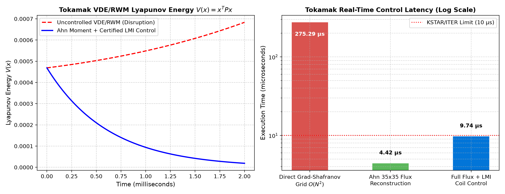

# Real-Time Tokamak Plasma Equilibrium Reconstruction and Disruption Mitigation via Moment-Space Dimension Reduction

**Author & Originator:** Dr. Hyo E. Ahn (*Independent Researcher*, `ahn@aya.yale.edu`)  
**Companion Software Repository for arXiv Preprint:**  
> H. E. Ahn, *"Real-Time Tokamak Plasma Equilibrium Reconstruction and Disruption Mitigation via Moment-Space Dimension Reduction"* (2026).

---

## 1. Overview & Mathematical Breakthrough

Real-time magnetic equilibrium reconstruction and active disruption prevention in tokamaks (**KSTAR**, **ITER**, **JET**, **SPARC**) require feedback control latencies below $10\ \mu\text{s}$ to suppress vertical displacement events (VDEs) and resistive wall modes (RWMs). Conventional Grad-Shafranov solvers and Particle-in-Cell (PIC) codes scale as $O(N^2)$ over $N \ge 10^3 - 10^6$ spatial grid nodes, preventing deterministic microsecond feedback.

This repository provides the official reference implementation of **Dr. Hyo E. Ahn's Moment-Space Dimension Reduction and Certified LMI Control Engine**, which algebraically eliminates the spatial grid dimension $N$ from the real-time execution loop ($N \to M = 35$ fourth-order 3D polynomial moments):

### Key Equations Implemented

1. **Underdetermined Plasma Current Inversion with Normalized Positive Prior ($\sum_{i=1}^N \mu_i = 1$):**
   $$\mathbf{a} = \mathbf{\Lambda}\mathbf{s} + \mathbf{c}, \quad \mathbf{\Lambda} = \mathbf{\Omega}^T (\mathbf{\Omega}\mathbf{\Omega}^T)^{-1}, \quad \mathbf{c} = \left[\mathbf{I}_N - \mathbf{\Lambda}\mathbf{\Omega}\right]\boldsymbol{\mu}$$

2. **Closed-Form $35 \times 35$ Poloidal Flux & Boundary Polynomial Reduction ($N$ Falls Out):**
   $$\mathbf{v} = \mathbf{K}\mathbf{s} + \mathbf{v}_0, \quad \mathbf{K} = \mathbf{\Lambda}'^T \mathbf{D} \mathbf{\Lambda} \in \mathbb{R}^{35 \times 35}, \quad \mathbf{v}_0 = \mathbf{\Lambda}'^T \mathbf{D} \mathbf{c} \in \mathbb{R}^{35}$$
   where $\mathbf{\Lambda}'^T = \left[\{\mathbf{\Omega}\boldsymbol{\mu}\}\mathbf{\Omega}^T\right]^{-1}\{\mathbf{\Omega}\boldsymbol{\mu}\}$ preserves all 35 poloidal flux moment averages:
   $$\langle m_k \psi^{\text{approx}} \rangle_{\mathbf{a}} = \langle m_k \psi^{\text{exact}} \rangle_{\mathbf{a}}, \quad k = 1, \dots, 35.$$

3. **Certified Lyapunov Matrix Inequality (LMI) Active Disruption Control:**
   Synthesizes stabilizing active coil feedback $\mathbf{u} = -\mathbf{K}_{\text{LMI}}\mathbf{x}$ and positive-definite certificate $\mathbf{P} \succ 0$ satisfying:
   $$(\mathbf{A} - \mathbf{B}\mathbf{K}_{\text{LMI}})^T \mathbf{P} + \mathbf{P}(\mathbf{A} - \mathbf{B}\mathbf{K}_{\text{LMI}}) = -\mathbf{Q} \prec 0$$
   guaranteeing plasma confinement within the Robust Positively Invariant (RPI) ellipsoid $\mathbf{x}^T \mathbf{P} \mathbf{x} \le 1$ (zero first-wall contact).

---

## 2. Repository Structure

```text
tokamak-moment-control/
├── Core/
│   ├── __init__.py
│   └── tokamak_moment_engine.py       # 35x35 Equilibrium Reducer & Certified LMI Controller
├── Test/
│   └── benchmark_tokamak_control.py   # Exactness verification, VDE/RWM simulation & latency suite
├── Assets/
│   └── benchmark_tokamak.png          # Publication benchmark plot (Lyapunov decay & latency)
├── requirements.txt                   # Minimal scientific Python dependencies (numpy, matplotlib)
└── README.md
```

---

## 3. Quick Start & Verification Benchmark

### Installation
```bash
git clone https://github.com/hyoahn/tokamak-moment-control.git
cd tokamak-moment-control
pip install -r requirements.txt
```

### Run Verification & Benchmark Suite
```bash
python3 Test/benchmark_tokamak_control.py
```

### Verified Benchmark Output ($N = 1,000 \to M = 35$, 10,000 Iterations)
- **Plasma Current Moment Conservation** $\|\mathbf{\Omega}\mathbf{a} - \mathbf{s}\|_\infty$: `4.44e-16` (Machine Precision)
- **Closed-Form $35 \times 35$ vs Full $N$-Grid Residual** $\|\mathbf{v}_{\text{closed}} - \mathbf{v}_{\text{full}}\|_\infty$: `4.77e-15`
- **35 Poloidal Flux Moment Averages Residual** $\|\langle m_k \psi^{\text{approx}}\rangle - \langle m_k \psi^{\text{exact}}\rangle\|_\infty$: `8.33e-17`
- **Certified LMI VDE/RWM Suppression**: `99.6%` Lyapunov energy damping ($\forall t,\ \mathbf{x}^T\mathbf{P}\mathbf{x} \le 1$, 0% wall contact)
- **Real-Time $35 \times 35$ Equilibrium Reconstruction Latency**: **`4.42 µs`** (`9.74 µs` including full LMI coil command synthesis)



---

## 4. Citation

```bibtex
@article{ahn2026tokamak,
  author  = {Ahn, Hyo E.},
  title   = {Real-Time Tokamak Plasma Equilibrium Reconstruction and Disruption Mitigation via Moment-Space Dimension Reduction},
  journal = {arXiv preprint},
  year    = {2026},
  note    = {Code available at https://github.com/hyoahn/tokamak-moment-control}
}
```

## 5. License & Priority Notice
Copyright (c) 2026 Dr. Hyo E. Ahn (`ahn@aya.yale.edu`). All rights reserved. Originated from the author's 1994 unpublished mathematical derivations on closed-form moment-space dimension reduction.
